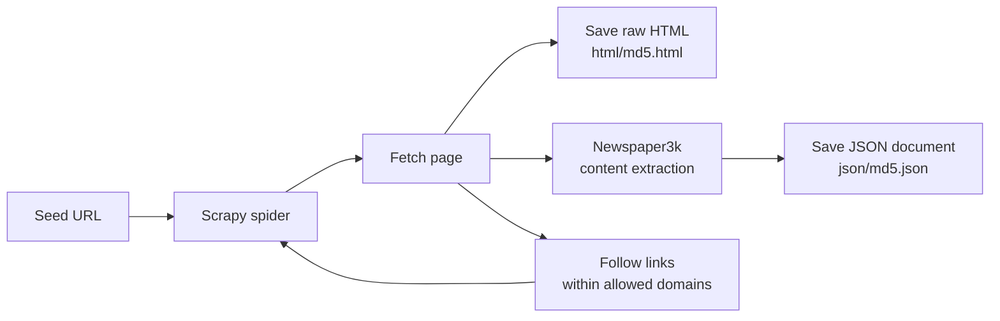

# Site to Disk

A [Scrapy](https://scrapy.org/) spider that crawls a website and stores every page to disk twice: the raw HTML, and a structured JSON document extracted with [Newspaper3k](https://newspaper.readthedocs.io/). The JSON documents include title, authors, publish date, body text, word count, keywords, and images, shaped so they can be bulk-loaded directly into a search engine such as Solr, OpenSearch, or Elasticsearch.

This is the front half of a search ingestion pipeline: crawl, extract, and persist. What you feed the documents into afterward is up to you.

## How it works



Every page gets a stable document id (the MD5 of its URL), which keeps re-crawls idempotent: crawling the same site twice overwrites documents instead of duplicating them. Links to image files are skipped, and the crawl stays inside the allowed domains.

## Installation

```bash
git clone https://github.com/jasonstubblefield/Scrapy_site_to_disk.git
cd Scrapy_site_to_disk
python3 -m venv env
source env/bin/activate
pip install -r requirements.txt
```

## Usage

Crawl the default site (apache.org):

```bash
scrapy runspider myspider.py
```

Crawl a site of your choosing:

```bash
scrapy runspider myspider.py -a start_url=https://example.com -a allowed=example.com,www.example.com
```

| Argument | Purpose |
|----------|---------|
| `start_url` | Seed URL where the crawl begins |
| `allowed` | Comma-separated list of domains the crawl may visit |

## Output

- `html/` holds the raw HTML of every crawled page, one file per page.
- `json/` holds the extracted JSON documents. Pages with no extractable body text get an HTML file but no JSON file.

A sample JSON document:

```json
{
  "id": "9a0364b9e99bb480dd25e1f0284c8555",
  "title": "Example Page",
  "authors": [],
  "publish_date": null,
  "text": "The extracted body text...",
  "word_count": 542,
  "keywords": [],
  "url": "https://example.com/page"
}
```

## License

MIT. See [LICENSE](LICENSE).
